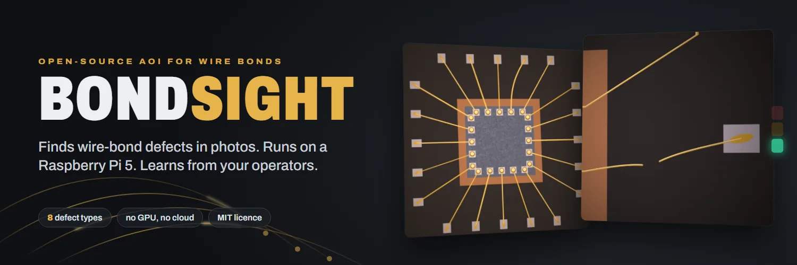
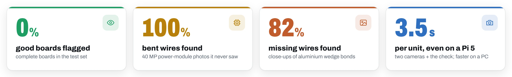
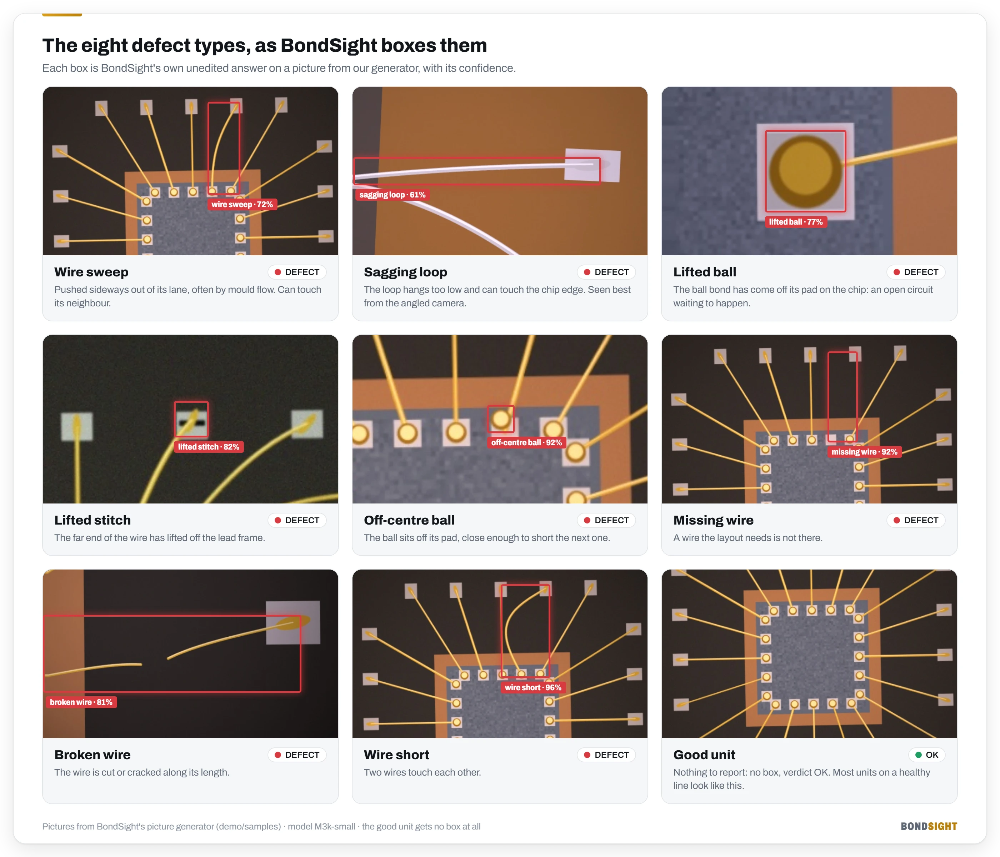
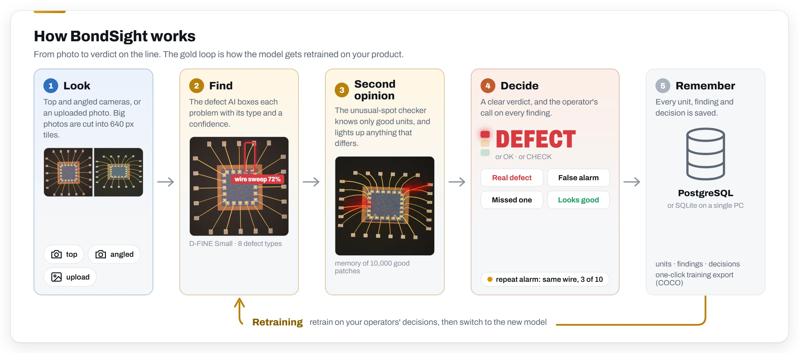
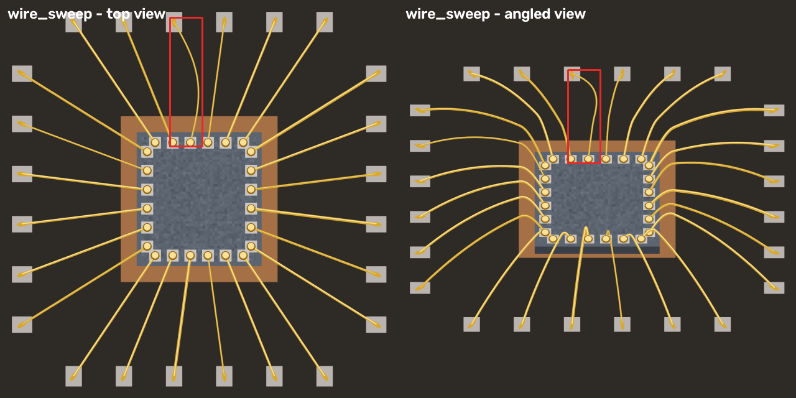
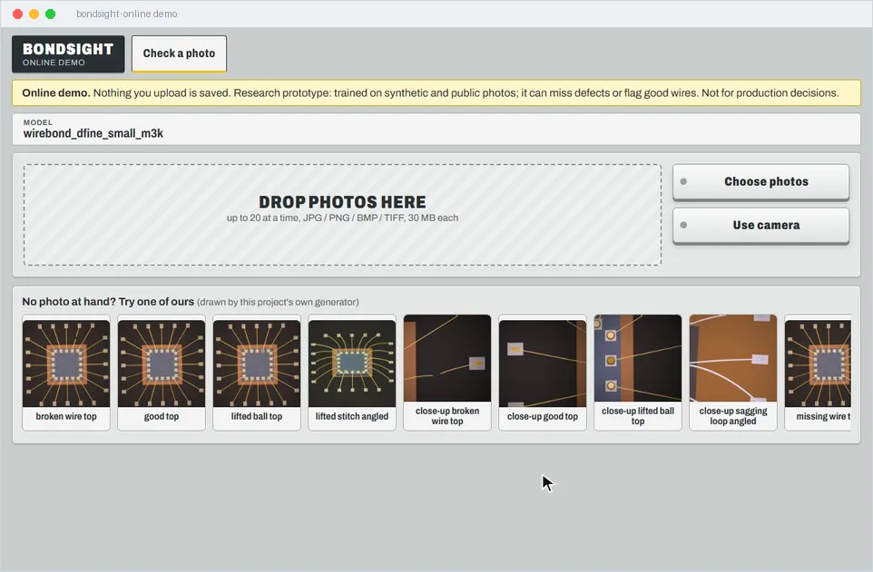
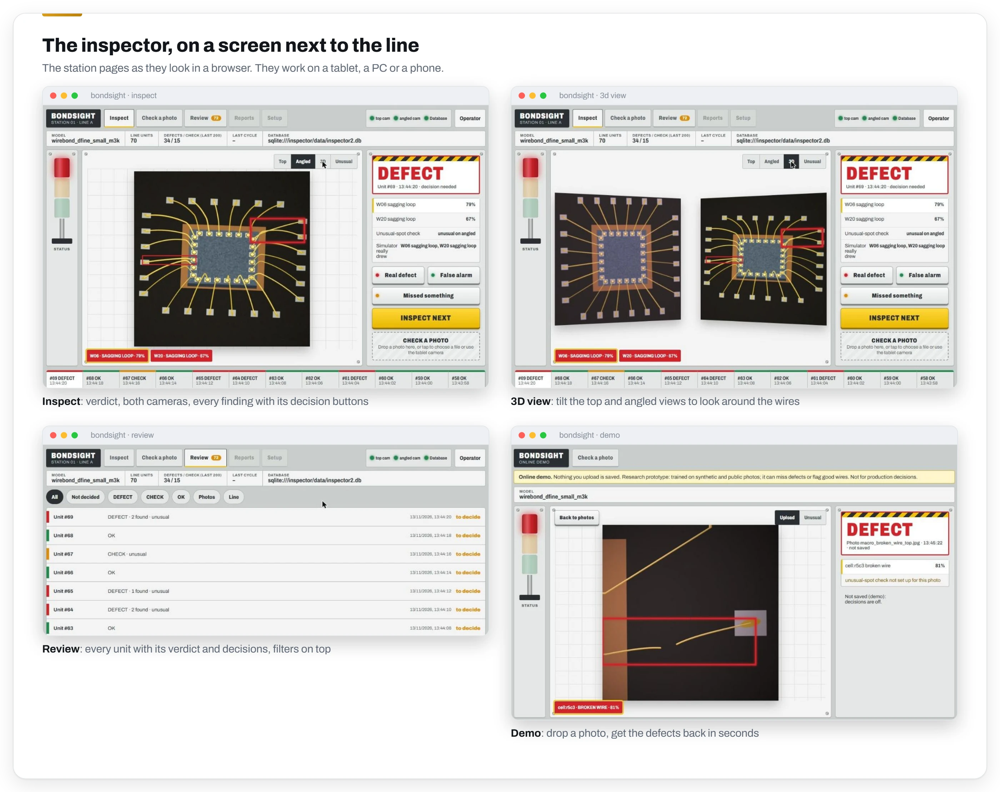
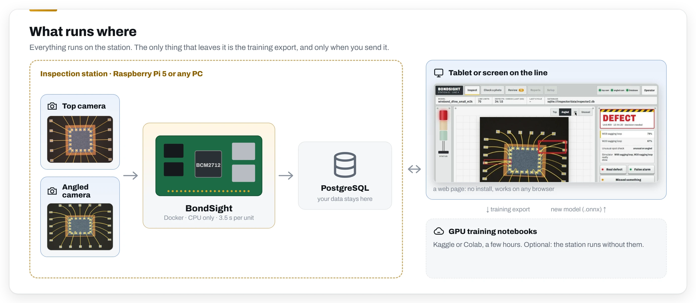

# BondSight

BondSight checks photos of wire-bonded chips for defects. It draws a box around each problem it
finds, says what kind of defect it is, and learns from the operators who confirm or reject its
calls. It runs on an ordinary PC, or on something as small as a Raspberry Pi 5, and it needs no
GPU, so the photos never have to leave the factory.

[](LICENSE)
[](#licence-and-credits)




I'm Avishek Mondal, a materials scientist. I've worked hands-on in semiconductor packaging: die
attach, wire bonding, encapsulation, yield and defect analysis. I started BondSight to learn how a
vision AI is built from start to finish, on a problem I already understand. Everything is open (the
picture generator, the training notebooks and the inspection station), so you can check how it
was done, use it, or improve it.

**Documentation:** [results, model by model](docs/results.md) ·
[the data, maths and models behind it](docs/technical.md) ·
[setting up the inspector](inspector/README.md) · [articles on wire bonding](articles/README.md)

## How well it works

<picture>
  <source media="(prefers-color-scheme: dark)" srcset="docs/images/fig-glance-dark.webp">
  
</picture>

These numbers come from test photos the model never saw during training. On the NTUST photos,
the hardest public set, it finds 63% of the defects. It found every bent wire in the Fuji
power-module test photos and 82% of the missing wires in the WHU close-ups, and it didn't flag any
of the complete good boards in the hawk-team set.

Some of those test photos come from the same sources as the training data, so on a new product
the numbers will be lower until the model has been trained on that product. The biggest single
improvement so far came from adding photos of good boards to the training: the share of good
boards wrongly flagged dropped from 100% to 0%.

It runs on the CPU, so any 64-bit Windows or Linux computer will do. The Raspberry Pi 5 is the
smallest machine it has been tested on: there, a two-camera unit takes about 3.5 s. On a laptop CPU
one photo takes 2.3 s instead of the Pi's 3.1 s, and a faster PC is quicker still.

All results are in [docs/results.md](docs/results.md). The data, the maths and the models are
explained in [docs/technical.md](docs/technical.md).

## What it finds

<picture>
  <source media="(prefers-color-scheme: dark)" srcset="docs/images/fig-gallery-dark.webp">
  
</picture>

Every unit gets a verdict. **OK** means nothing was found. **DEFECT** means at least one box, each
linked to its wire (for example W05) and given a confidence. **CHECK** means the detector found
nothing it knows, but a second model, trained only on good units, thinks something looks wrong,
so a person should take a look.

If the same defect shows up on the same wire in 3 of the last 10 units, BondSight raises a repeat
alarm. A pattern like that usually points at the machine, such as a worn capillary or a setting
that has drifted, rather than at one bad unit.

## How it works

<picture>
  <source media="(prefers-color-scheme: dark)" srcset="docs/images/fig-how-dark.webp">
  
</picture>

Each camera photographs the unit, one from the top and one at an angle. Large photos are cut into
overlapping 640 × 640 tiles so thin wires don't disappear when the picture is shrunk. The
detector is a D-FINE Small model fine-tuned on wire bonds. It returns boxes with a defect type and
a score, and each defect type has its own score threshold. The unusual-spot checker then compares
the picture with what it remembers of good units.

The operator answers each finding with one tap: real defect, false alarm, missed something (and
draws a box around it), or looks good. The answers are stored with the photos and can be exported
as training data, so the next model learns from the line it actually runs on.

The maths behind each step (tiling, the detector and its training loss, how the confidence levels
are chosen, the unusual-spot score and the repeat alarm) is written out, with charts, in
[docs/technical.md](docs/technical.md).

## Training without real photos

When I started I had no photos of defective bonds, so BondSight has its own picture generator. It
draws chips with any number of wires, from the top or at an angle, whole or in close-up, and puts
any of the eight defects exactly where you ask, already labelled.

The first model, trained only on these drawings, failed on real photos: it boxed defects but got
none of their types right. Adding a few hundred real photos to the training took it to 42% of real
defects found, and later steps took it to where it is now. The whole story is in
[docs/results.md](docs/results.md). The generator is still useful for teaching the model a new chip
layout before you have many real photos of it.



## See it



<picture>
  <source media="(prefers-color-scheme: dark)" srcset="docs/images/fig-screens-dark.webp">
  
</picture>

The station page is designed for a touchscreen next to the bonder, with a stack light you can read
from across the room. You can also drop in a photo of any part that looks suspicious and get an
answer in a few seconds.

## Try it

On a PC with Python 3.11, using two simulated cameras (no camera needed):

```bash
python -m venv inspector/.venv
inspector/.venv/Scripts/python -m pip install -e synth -e "inspector[test]"   # Linux/macOS: .venv/bin/
cp inspector/config.example.yaml inspector/config.yaml
mkdir -p inspector/models
curl -L -o inspector/models/wirebond_dfine_small_m3k.onnx https://github.com/Avishek2410/bondsight/releases/download/v0.1.0/wirebond_dfine_small_m3k.onnx
curl -L -o inspector/models/wirebond_dfine_small_m3k.json https://github.com/Avishek2410/bondsight/releases/download/v0.1.0/wirebond_dfine_small_m3k.json
inspector/.venv/Scripts/wbinspect --config inspector/config.yaml
```

Then open http://127.0.0.1:8080 and press **INSPECT NEXT**.

With Docker and PostgreSQL, on a PC or a Raspberry Pi 5:

```bash
mkdir -p docker/models docker/data && cp inspector/models/wirebond_dfine_small_m3k.* docker/models/
cp docker/config.docker.yaml docker/config.yaml
python3 docker/make_env.py                 # random database password, kept out of git
cd docker && docker compose up -d --build
```

<picture>
  <source media="(prefers-color-scheme: dark)" srcset="docs/images/fig-deploy-dark.webp">
  
</picture>

The model files are kept out of the code and published with the
[v0.1.0 release](https://github.com/Avishek2410/bondsight/releases/tag/v0.1.0), along with the
credits of the photos they learned from ([CREDITS.md](CREDITS.md)). You can also train your own
with the notebooks in [`training/`](training/). Setup, camera settings and the online-demo mode
are described in [inspector/README.md](inspector/README.md).

## Using it on a real line

If you want to try it on your own parts, start by running it next to your current inspection,
with your own cameras and lighting. Let the operators answer what it flags and mark what it misses.
Retrain on those answers, which takes a few hours on a free cloud GPU, and repeat until the misses
and false alarms are at a level your quality plan accepts. Until then, treat it as a second pair of
eyes rather than a replacement for your inspection.

If you run wire bonders and would like to pilot it, please open an issue.

## What's in this repository

```
synth/      the picture generator (8 defect types, top + angled views, close-ups)
training/   notebooks that train the D-FINE detector and export it to ONNX
inspector/  BondSight: cameras or photos -> AI -> verdict -> operator decisions -> database
docker/     Dockerfile + compose (BondSight + PostgreSQL) for a PC or a Raspberry Pi 5
demo/       the online demo: sample pictures and the Hugging Face Space template
articles/   the article series (full versions)      linkedin/  short versions
docs/       results, design documents, plans and the pictures on this page
```

## Articles

I'm writing a series on wire bonding for people new to it: how chips are wired, how bonds fail,
how they're inspected, and how BondSight was built. It starts [here](articles/README.md).

## Roadmap

- [x] Picture generator, detector training, ONNX export
- [x] Inspection station: PC + Raspberry Pi 5, Docker, PostgreSQL, operator decisions, training export
- [x] Online demo mode (nothing saved)
- [ ] Demo online on Hugging Face Spaces
- [ ] Camera auto-detection and setup wizard; Raspberry Pi camera driver
- [ ] Reports, CSV export, operator PIN logins, audit log
- [ ] First production-line pilot

## Licence and credits

The code is under the [MIT licence](LICENSE). Text and pictures made for this project are under
CC BY 4.0, so you can share and adapt them as long as you give credit.

The trained models learned from photos and networks made by other people: CC BY 4.0 photos from
National Taiwan University of Science and Technology, WHUrobotics, hawk-team, lyra-wikbf and
pg-87jvm on Roboflow Universe, plus D-FINE (Apache-2.0) and ResNet18 (BSD-3-Clause).
[CREDITS.md](CREDITS.md) lists who made what and what we changed, and
[DATA_SOURCES.md](DATA_SOURCES.md) lists where all the data comes from. No third-party photos are
stored in this repository.
