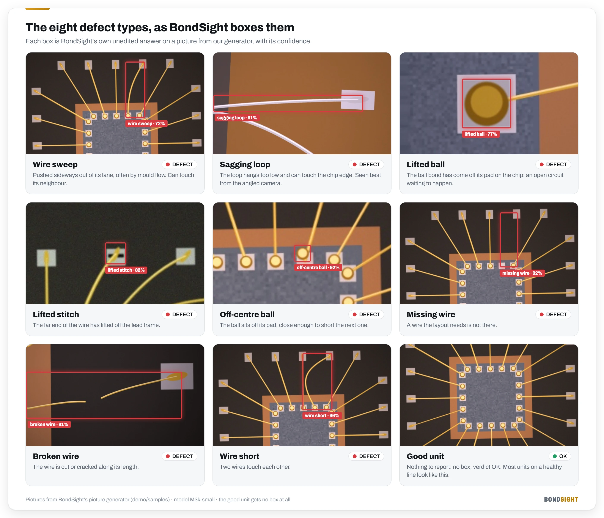

# BondSight: wire-bond defect detector

BondSight finds defects in photos of wire-bonded chips. It draws a box around each problem, names
it and gives a confidence. This is the trained model; the inspection station that runs it, the
training notebooks and all the documentation are on GitHub:
**https://github.com/Avishek2410/bondsight**



## What it detects

Eight defect types: `wire_sweep`, `sagging_loop`, `lifted_ball`, `lifted_stitch`,
`off_center_ball`, `missing_wire`, `broken_wire` and `wire_short`. Each type has its own
confidence level, stored in the `.json` next to the model.

## Files

| File | What it is |
|---|---|
| `wirebond_dfine_small_m3k.onnx` | The detector: D-FINE Small (10.2 M parameters), fine-tuned for wire bonds. Input 640 × 640 RGB, outputs 300 candidate boxes with a score for each type. |
| `wirebond_dfine_small_m3k.json` | Class names, the confidence level for each type, and the tiling settings for large photos. Keep it next to the `.onnx`. |
| `anomaly_backbone.onnx` + `.json` | Optional: the feature extractor for BondSight's unusual-spot checker (ResNet18, ImageNet weights, unchanged). |
| `CREDITS.md` | Who made the photos and networks the model learned from. Keep it with the model files if you share them. |

## How well it works

Measured on test photos the model never saw during training:

| Test set | Result |
|---|---|
| Real defects found (NTUST wire-bonding photos) | 63% |
| Missing wires found (WHU close-ups) | 82% |
| Bent wires found (Fuji power-module photos) | 100% |
| Complete good boards wrongly flagged (hawk-team) | 0% |
| Good chips wrongly flagged (lyra) | 18% |
| Good modules wrongly flagged (Fuji Pass) | 49% |

Some of these test photos come from the same sources as the training data, so on a new product
expect lower numbers until the model has been fine-tuned on that product's photos. It is a
research prototype, not a validated inspection system. The full results, and how each earlier model
did, are in [docs/results.md](https://github.com/Avishek2410/bondsight/blob/main/docs/results.md).

Speed, CPU only with ONNX Runtime: 3.1 s for one 2048-pixel photo on a Raspberry Pi 5, 2.3 s on a
laptop CPU.

## How to use it

The simplest way is the BondSight inspector, which handles tiling of large photos, the per-type
confidence levels, a web page for operators and a database:

```bash
git clone https://github.com/Avishek2410/bondsight
cd bondsight
python -m venv inspector/.venv
inspector/.venv/Scripts/python -m pip install -e synth -e inspector     # Linux/macOS: .venv/bin/
```

Then, in Python:

```python
from huggingface_hub import hf_hub_download
from PIL import Image
from wirebond_inspector.detector import OnnxDetector

model = hf_hub_download("Avishek2410/bondsight", "wirebond_dfine_small_m3k.onnx")
hf_hub_download("Avishek2410/bondsight", "wirebond_dfine_small_m3k.json")   # settings, same folder

detector = OnnxDetector(model)
for f in detector.detect(Image.open("my_photo.jpg"), threshold=0.3):
    print(f.cls, round(f.score, 2), f.box)       # box = x0, y0, x1, y1 in pixels
```

Large photos are shrunk to half size and cut into overlapping 640 × 640 tiles automatically.
How the detector, the tiling and the confidence levels work is explained, with the maths, in
[docs/technical.md](https://github.com/Avishek2410/bondsight/blob/main/docs/technical.md).

## Training

Fine-tuned from D-FINE Small COCO weights for 12 epochs on a Kaggle T4 GPU (AdamW, learning rate
2e-4, one-cycle schedule); the epoch with the lowest validation loss (epoch 6) was kept. Each
epoch saw 6,367 pictures: drawings from BondSight's own picture generator and tiles from six
public photo sets, including photos of good boards so the model learns what not to flag.

## Credits and licence

The model files are released under **CC BY 4.0**: you can use and adapt them, including
commercially, as long as you give credit to BondSight (Avishek Mondal) and keep `CREDITS.md`
with them.

The model learned from CC BY 4.0 photos by National Taiwan University of Science and Technology,
WHUrobotics, hawk-team, lyra-wikbf and pg-87jvm (Roboflow Universe), and starts from D-FINE
(Peng et al., 2024; Apache-2.0). The checker uses torchvision's ResNet18 (BSD-3-Clause). Details
of who made what and what was changed are in `CREDITS.md`.

## Citation

```bibtex
@software{mondal_bondsight_2026,
  author  = {Mondal, Avishek},
  title   = {BondSight: open-source AOI for wire bonds},
  year    = {2026},
  version = {0.1.0},
  url     = {https://github.com/Avishek2410/bondsight}
}
```
