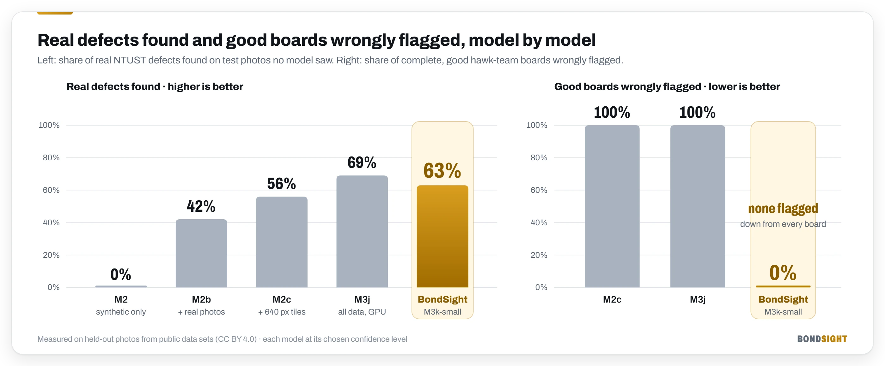
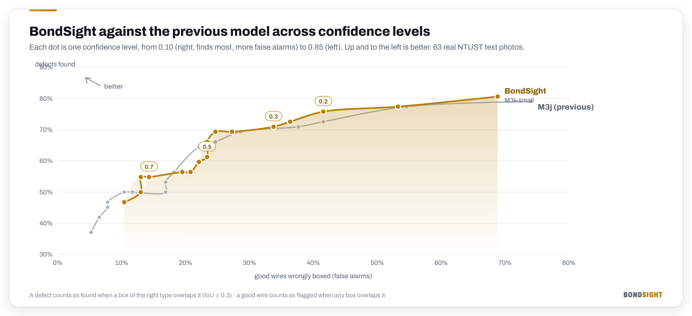
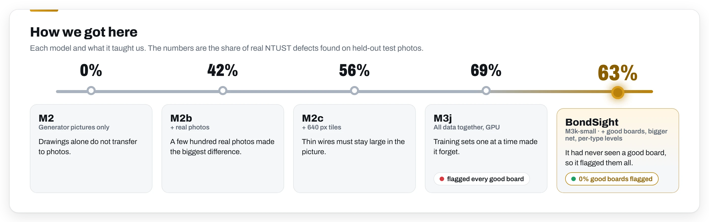

# BondSight: results and how we got here

Every number on this page is measured on photos the model never saw during training.
Back to the [front page](../README.md).

<picture>
  <source media="(prefers-color-scheme: dark)" srcset="images/fig-results-dark.webp">
  
</picture>

Finding more always costs some false alarms. This is the trade-off on real NTUST test photos as
the confidence level moves (details in [technical.md](technical.md)):

<picture>
  <source media="(prefers-color-scheme: dark)" srcset="images/fig-sweep-dark.webp">
  
</picture>

## All models, all test sets

| | M2 | M2b | M2c | M3j | **M3k-small (BondSight now)** |
|---|---|---|---|---|---|
| Real NTUST defects found | 0% ¹ | 42% | 56% | 69% | **63%** |
| Missing wires found (WHU new_photos) | – | – | 5% | 91% | **82%** |
| Bent wires found (Fuji power modules) | – | – | 50% | 71% | **100%** |
| Good boards wrongly flagged (hawk-team) | – | – | 100% | 100% | **0%** |
| Good chips wrongly flagged (lyra) | – | – | 82% | 55% | **18%** |
| Good modules wrongly flagged (Fuji Pass) | – | – | 100% | 100% | **49%** |

¹ M2 boxed 66% of real defects but gave none the right type.

How to read it:
- The test photos are held-out photos from the same public sets the later models trained on, so
  the good-board numbers in particular are likely better than on a product the model has never seen.
- M3k-small gives up a few points of detection compared with M3j for far fewer false alarms, which
  matters more on a real line: operators stop trusting a station that flags every good board.
- On a new line, expect it to miss some defects and flag some good units until it has learned from
  that line's own photos (see "Learns your line" on the front page).

**Speed.** Raspberry Pi 5, CPU only: about 3.5 s per unit with two cameras and the unusual-spot
checker; 3.1 s for one 2048-pixel photo (2.3 s on a recent laptop CPU).

## How we got here

<picture>
  <source media="(prefers-color-scheme: dark)" srcset="images/fig-journey-dark.webp">
  
</picture>

| Model | What changed | What it taught us |
|---|---|---|
| M2 | Trained only on pictures from our generator | Drawings alone do not transfer: perfect on drawings, wrong on photos |
| M2b | Fine-tuned on real NTUST photos | A few hundred real photos made the biggest difference |
| M2c | Big photos cut into overlapping 640 px tiles | Small wires need to stay large in the picture |
| M2d, M2e, M2f | MEMS photos, close-up drawings, missing-wire photos, one at a time | Adding one data set at a time made the model forget others |
| M3j | Everything trained together on a Kaggle GPU | Joint training fixed the forgetting |
| M3k-small | Photos of good boards and chips, bent-wire photos, a bigger network, one confidence level per defect type | It flagged good boards because it had never seen any; adding good examples fixed that |

The training notebooks for every step are in [`training/`](../training/); the data sources and
their licences are in [DATA_SOURCES.md](../DATA_SOURCES.md) and [CREDITS.md](../CREDITS.md).
