# How BondSight works: data, maths and models

This page covers the engineering. For what BondSight does and how to try it, see the [front page](../README.md);
for every measured number, see [results](results.md).

<picture>
  <source media="(prefers-color-scheme: dark)" srcset="images/fig-pipeline-dark.webp">
  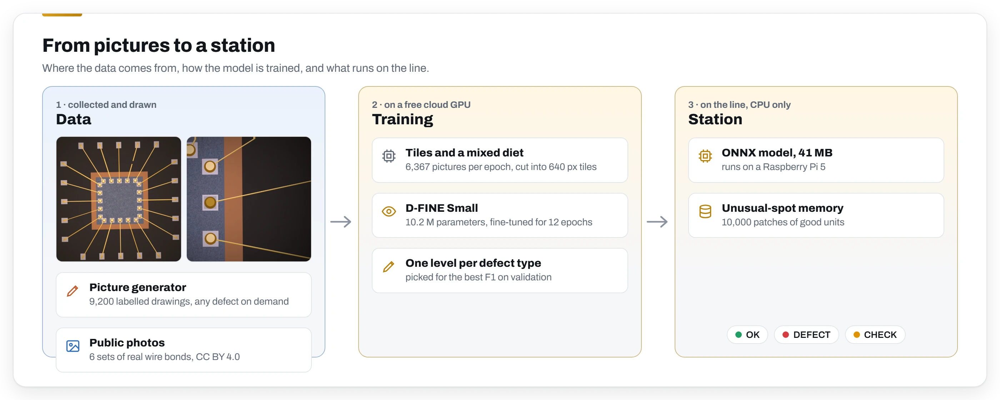
</picture>

## 1. The data

### The picture generator (our own)

BondSight first learned from pictures it drew itself. The generator (`synth/`) builds a chip
package from numbers: die, bond pads, lead fingers and wires with realistic loop shapes. It then
renders it from the **top** and at an **angle**, with lighting, texture and noise. Every defect is
placed on purpose, so every picture comes with exact labels for free.

| What it varies | How |
|---|---|
| Design | 8 to 40 wires; pad and lead layout from a random seed (one seed = one product design) |
| Defects | all 8 types; *random* (any wire, small probability) or *repetitive* (the same wire fails again and again, like a worn tool) |
| Mould-flow sweep | whole rows of wires bent by a simulated flow, with a strength limit |
| Close-ups (`--macro`) | 2× to 4× zoom on one wire; 5 background styles; gold ball bonds or aluminium wedge bonds |
| Training set | 7,200 whole-chip pictures + 2,000 close-ups |

| Wire sweep | Broken wire | Missing wire | Lifted ball |
|---|---|---|---|
| 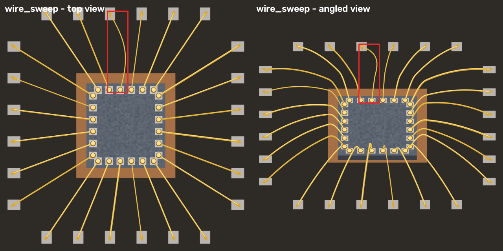 | 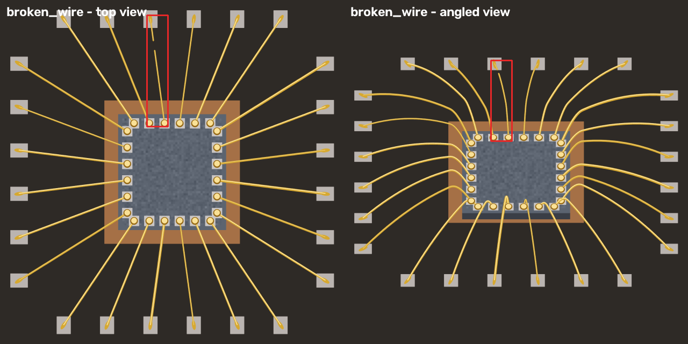 | 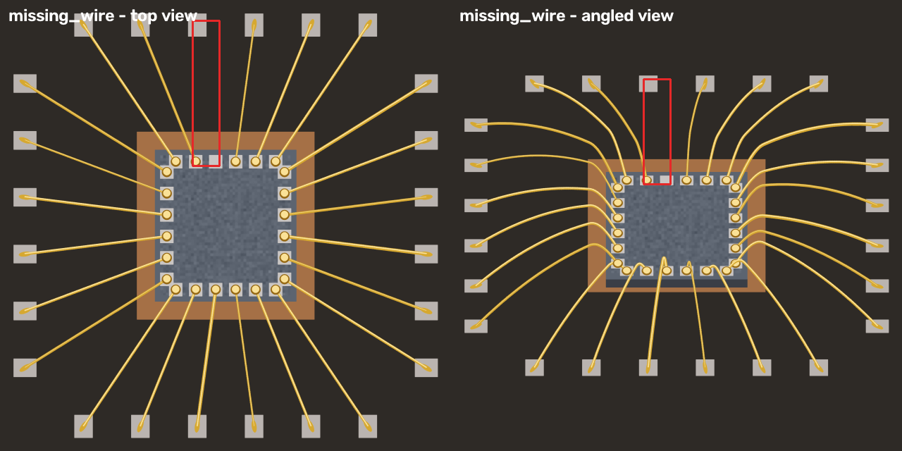 | 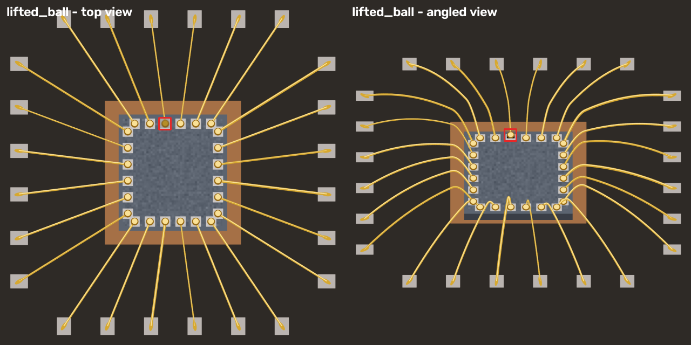 |

Drawings alone were not enough: the first model scored perfectly on drawings and found **none** of
the real defects with the right type. Real photos fixed that; the generator still supplies the
volume and the rare defects.

### Real photos (public, credited)

All six sets are CC BY 4.0 from Roboflow Universe, split into train / validation / test **by photo**,
so a test photo is never seen in training. None of these photos are stored in this repository.

| Set | What it shows | Used as | Train / val / test |
|---|---|---|---|
| NTUST *wire bonding* | gold ball bonds; sagged, missing, broken wires | defects | 79 / 11 / 23 photos |
| WHU *mems_60* | MEMS sensors with broken wires | defects (+ close-up crops) | 43 / 6 / 12 photos |
| WHU *new_photos* | aluminium wedge bonds, wires gone from their pads | missing-wire defects | 109 / 10 / 30 photos |
| hawk-team *Wire* | complete boards, every wire traced | **good** wires (no defect) | 184 / 47 / 26 boards |
| lyra-wikbf *chip* | power chips | **good** units | 75 / 22 / 11 photos |
| pg-87jvm *Fuji Wire Inspection* | 40-megapixel power modules | bent wires + good modules | 382 train / 160 test |

Labels were mapped onto BondSight's 8 types (for example *sagged wire* → `wire_sweep`), and boards
with half-bonded or damaged wiring were left out of the "good" set. The details of every change are
in [CREDITS.md](../CREDITS.md) and [DATA_SOURCES.md](../DATA_SOURCES.md).

### Cutting big photos into tiles

A 2048-pixel photo shrunk to the network's 640 pixels would make a wire one pixel wide. So big
photos are **shrunk to half size and cut into 640 × 640 tiles every 320 pixels**: neighbouring tiles
overlap by half, and every wire appears whole in at least one tile.

<picture>
  <source media="(prefers-color-scheme: dark)" srcset="images/fig-tiling-dark.webp">
  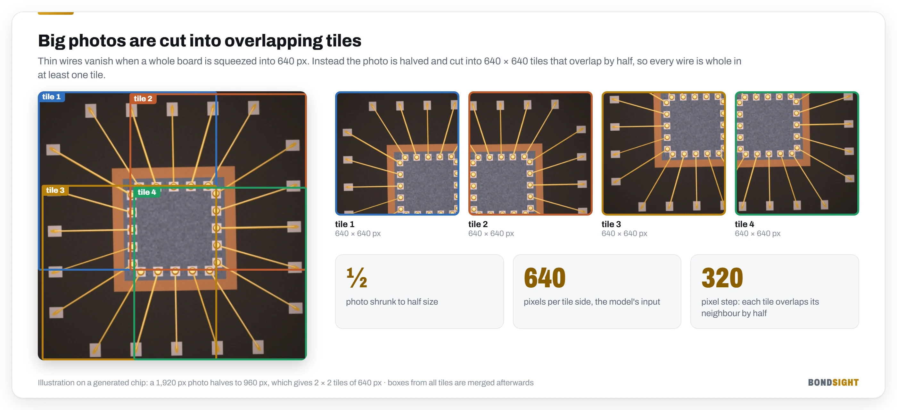
</picture>

In training, a tile that would show less than **60%** of a defect box is skipped, so the model is
never taught on a half-cut defect. At inspection time, boxes from all tiles are moved back to
photo coordinates and duplicates are removed with **non-maximum suppression** (per type, a box that
overlaps a better one by more than IoU 0.5 is dropped), where

$$\mathrm{IoU}(A,B)=\frac{|A\cap B|}{|A\cup B|}.$$

### The mix the model sees in each epoch

Each epoch draws a fresh, balanced sample, so no single source dominates and the model does not
forget what it learned earlier:

<picture>
  <source media="(prefers-color-scheme: dark)" srcset="images/fig-mix-dark.webp">
  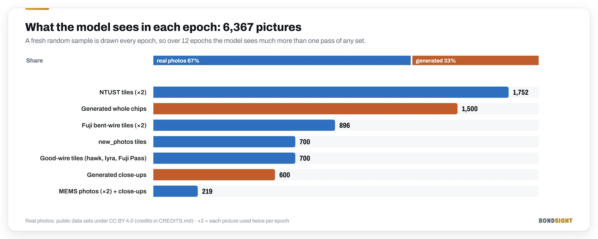
</picture>

## 2. The detector: D-FINE

BondSight's detector is **D-FINE Small** (10.2 M parameters, Apache-2.0, Peng et al. 2024), a
real-time detection transformer that starts from weights trained on everyday photos (COCO) and is
fine-tuned here. A smaller sibling, D-FINE Nano (3.7 M), was used for the earlier models.

<picture>
  <source media="(prefers-color-scheme: dark)" srcset="images/fig-dfine-dark.webp">
  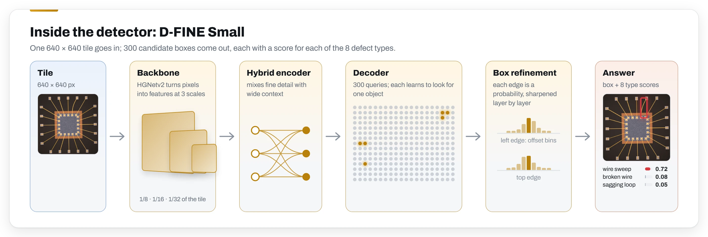
</picture>

- **No anchors, no hand-made box grid.** The decoder holds 300 *queries*; each one learns to look
  for one object and returns a box and a score for each of the 8 types.
- **Boxes as distributions.** Instead of predicting each box edge as one number, D-FINE predicts a
  probability distribution over small offsets for each edge and refines it layer by layer
  (*fine-grained distribution refinement*). Deeper layers also teach shallower ones
  (*self-distillation*). This makes boxes tight on thin objects such as wires.
- **Scores.** Each query's score for type *c* is a sigmoid of its output, $p_c = 1/(1+e^{-z_c})$.

### How it learns

Training matches each true defect to one query (Hungarian matching on type and box cost), then
adds up D-FINE's standard losses with its default weights:

$$\mathcal{L} = \lambda_{\text{cls}}\,\mathcal{L}_{\text{VFL}} + \lambda_{\text{L1}}\,\mathcal{L}_{\text{L1}} + \lambda_{\text{GIoU}}\,\mathcal{L}_{\text{GIoU}} + \lambda_{\text{FGL}}\,\mathcal{L}_{\text{FGL}} + \lambda_{\text{DDF}}\,\mathcal{L}_{\text{DDF}}$$

| Term | What it pushes the model to do |
|---|---|
| VFL (varifocal loss) | give a high score to the right type, scaled by how well the box fits |
| L1 | put the box edges in the right place |
| GIoU | maximise box overlap, even when boxes do not touch yet |
| FGL (fine-grained localization) | sharpen each edge's distribution around the true position |
| DDF (decoupled distillation) | let the final layer teach the earlier ones |

| Setting | Value |
|---|---|
| Optimiser | AdamW, learning rate 2 × 10⁻⁴, weight decay 10⁻⁴ |
| Schedule | one-cycle: 10% warm-up, then smoothly down |
| Batch | 16 tiles, mixed precision on an NVIDIA T4 (Kaggle) |
| Gradient clipping | norm 0.1 |
| Epochs | 12; the epoch with the lowest validation loss is kept (epoch 6 for M3k-small) |
| Time | about 4.5 minutes per epoch, about 1 hour in all |

<picture>
  <source media="(prefers-color-scheme: dark)" srcset="images/fig-curves-dark.webp">
  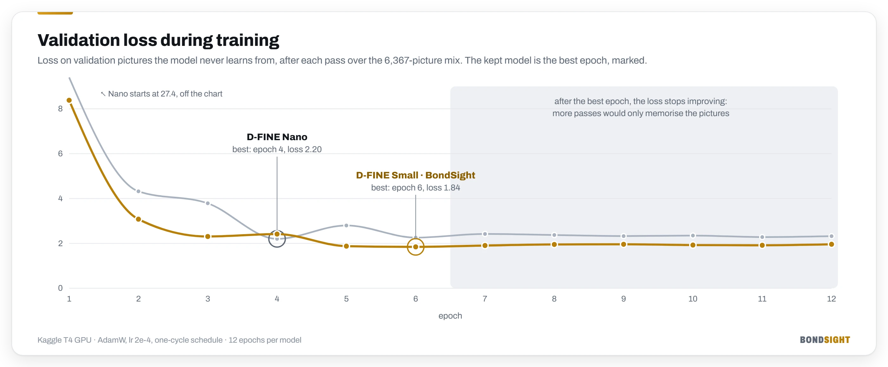
</picture>

The validation loss drops fast for three epochs, then flattens: after that the model mostly
memorises its training pictures, so the epoch with the lowest validation loss is the one kept.
The larger Small network ends lower than Nano, which is why BondSight now uses it.

### One confidence level per defect type

One cut-off for every type works badly, because some types get much lower scores than others even when
the model is right. After training, each type gets its own level, chosen on
validation pictures from 0.20 to 0.80 (steps of 0.05) to maximise

$$F_1 = \frac{2PR}{P+R},\qquad P=\frac{\text{correct boxes}}{\text{all boxes}},\quad R=\frac{\text{defects found}}{\text{all defects}}.$$

Types with fewer than 8 validation examples keep 0.30. The levels travel inside the model's
`.json` file, so the station uses exactly what was chosen.

<picture>
  <source media="(prefers-color-scheme: dark)" srcset="images/fig-levels-dark.webp">
  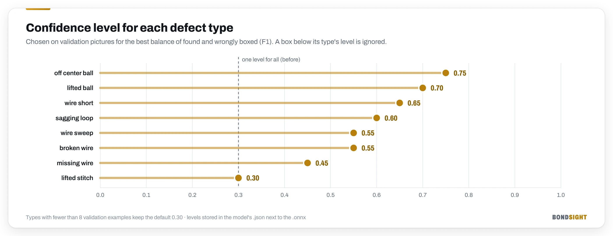
</picture>

Every level is a trade-off between finding more and boxing good wires by mistake. Moving one
level across its whole range on real test photos shows the curve the station chooses a point on:

<picture>
  <source media="(prefers-color-scheme: dark)" srcset="images/fig-sweep-dark.webp">
  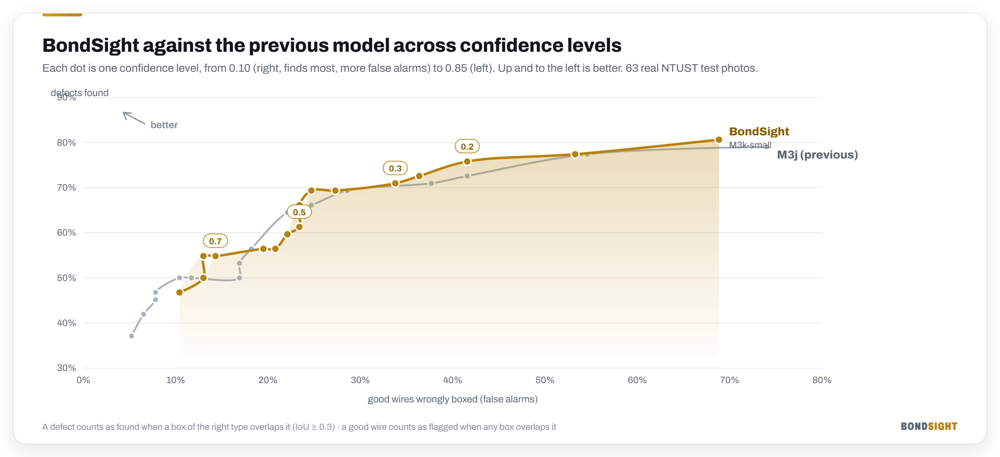
</picture>

At the same confidence level BondSight finds more real defects than the previous model; at the
same rate of false alarms the two are close, with BondSight ahead in most of the range.

### From PyTorch to the Pi

The trained model is exported to **ONNX** (41 MB) and run with **ONNX Runtime** on the CPU, so the
station needs no PyTorch and no GPU. Before release, both versions are run on the same 12 real
tiles and must give the same boxes.

<picture>
  <source media="(prefers-color-scheme: dark)" srcset="images/fig-speed-dark.webp">
  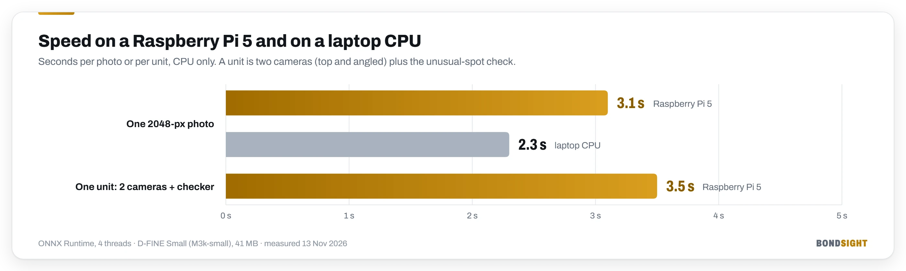
</picture>

## 3. The second opinion: unusual-spot checker

The detector only knows its 8 types. The checker knows only **what good units look like**, so it
can flag anything else: a scratch, a particle, a wire in a strange place. It follows the idea of
*PatchCore* (Roth et al., 2022); the code is BondSight's own.

<picture>
  <source media="(prefers-color-scheme: dark)" srcset="images/fig-unusual-dark.webp">
  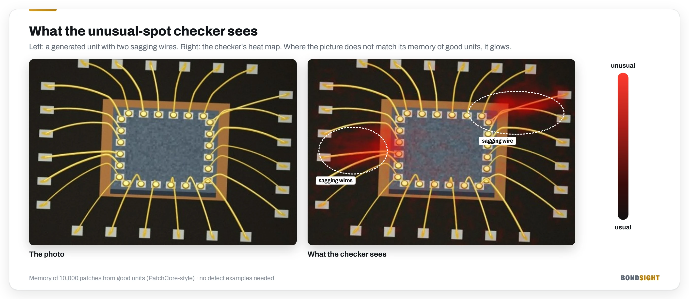
</picture>

1. **Describe patches.** A ResNet18 trained on everyday photos (BSD-3, unchanged) turns a 640-pixel
   picture into an 80 × 80 grid of patches, each described by 384 numbers (layers 2 and 3).
2. **Remember good patches.** Patches from good units go into a memory bank, thinned to the 10,000
   most spread-out ones (*coreset*: repeatedly keep the patch farthest from those already kept).
3. **Score a new unit.** Each patch's distance to its nearest remembered good patch says how
   unusual that spot is; the picture's score is the most unusual spot:

$$s(x) = \max_{i} \min_{m \in \mathcal{M}} \lVert f_i(x) - m \rVert_2$$

4. **Set the alarm.** Good units that were *not* put in memory are scored; the alarm level is the
   highest of their scores (× a margin of 1.0). A unit above it, with no named defect, becomes **CHECK**.

<picture>
  <source media="(prefers-color-scheme: dark)" srcset="images/fig-checker-dark.webp">
  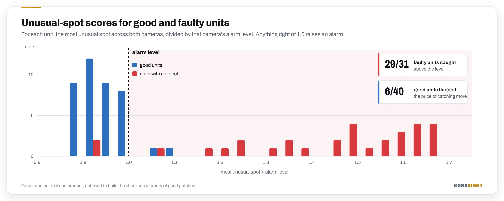
</picture>

One memory per camera, because the top and angled views look different. On 71 fresh generated
units of one product, 29 of the 31 units with a defect scored above the alarm level, and so did 6
of the 40 good units: the checker is a sensitive "please look" signal, which is why it only ever
says CHECK and never DEFECT.

## 4. Repeat alarm

Each box is tied to a position: the wire it lies on (using the product's wire map), or a grid cell
when there is no map. For every (position, type) pair BondSight keeps the last *m* = 10 units and
raises an alarm when it appears in at least *k* = 3 of them:

$$\text{alarm}(p,c) \iff \sum_{u=n-9}^{n} \mathbb{1}\left[(p,c)\in\text{findings}(u)\right] \ge 3$$

A random defect rarely hits the same wire twice in a row. A worn capillary or a wrong loop setting
keeps hitting it.

<picture>
  <source media="(prefers-color-scheme: dark)" srcset="images/fig-repeat-dark.webp">
  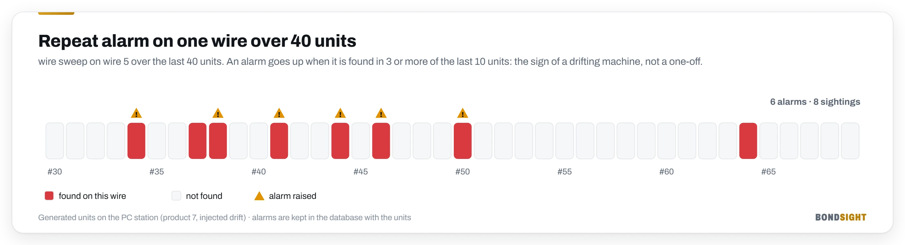
</picture>

## 5. Learning from the line

Every operator decision is stored: *real* keeps the box, *false alarm* drops it but keeps the
picture (a "hard negative": a look-alike the model must learn to ignore), *missed* adds the box the
operator drew, *looks good* marks a clean unit. `wbinspect-export` writes all decided units in
COCO format, the same format the training notebooks read, so the next model can be trained on the
line it actually runs on.

## Further reading

- Y. Peng et al., *D-FINE: Redefine Regression Task in DETRs as Fine-grained Distribution
  Refinement*, 2024.
- K. Roth et al., *Towards Total Recall in Industrial Anomaly Detection* (PatchCore), CVPR 2022.
- K. He et al., *Deep Residual Learning for Image Recognition* (ResNet), CVPR 2016.
